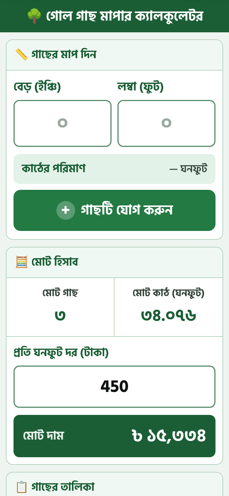

# 🌳 গোল গাছ মাপার ক্যালকুলেটর · Round-Log Wood Calculator

An offline Bengali calculator that works out the volume of round logs in cubic feet (ঘনফুট) and their price, built for a timber buyer who isn't comfortable with technology.

**[Open the live app →](https://thealamin.com/calculator/)**

## What it does

- Enter the girth (বেড়) in inches and the length (লম্বা) in feet, and see the volume as you type
- Uses the standard quarter-girth formula: `girth² × length ÷ 2304`
- Add as many logs as you need. The total wood, rate per cubic foot (টাকা) and total price stay at the top
- Edit or delete any log. A deleted log can be brought back with one tap (↩ ফিরিয়ে আনুন)
- Give each list an optional name, such as the buyer or village
- Send the full list and total to WhatsApp or SMS (📤 হিসাব পাঠান)
- Past lists are saved in "আগের হিসাব", so nothing is lost when a new list starts

## Built for a real user

- **Bengali everywhere:** Bengali digits (৪৮ is read correctly), prices grouped the Bangladeshi way (৳ ৫৬,২৭,৭৫০), and an included Bengali font
- **Easy to use:** large text and buttons, clear messages after every action, the Enter key moves from girth to length and then adds the log, and the phone's Back button closes screens instead of the app
- **Nothing gets lost:** the list, rate and name are saved after every change, so a phone call or a closed app doesn't erase the work
- **Totals you can trust:** each log is rounded first, so the rows always add up to the total
- **Works offline** and installs on a phone's home screen like an app (PWA with a service worker)
- **No sign-up, no ads, no data collected.** Everything stays on the device

## Tech

Plain HTML, CSS and JavaScript (code kept in `app.js`, so it runs under a strict Content Security Policy with no inline scripts) · Web App Manifest · Service Worker for offline use · [Hind Siliguri](https://fonts.google.com/specimen/Hind+Siliguri) font (SIL Open Font License, see `fonts/OFL-LICENSE.txt`)

To publish an update, upload all the files and change the cache name in `sw.js` (for example `gach-calc-v8` to `gach-calc-v9`), so installed phones pick up the new version.

---

Made by [Alamin](https://thealamin.com), website designer, developer and cyber security expert. Need a custom tool or website for your business? [Let's talk](https://thealamin.com/contact.html).
